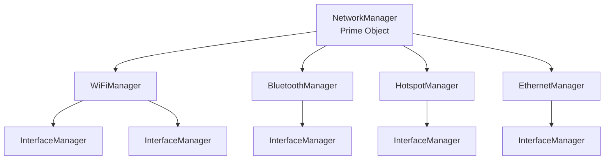
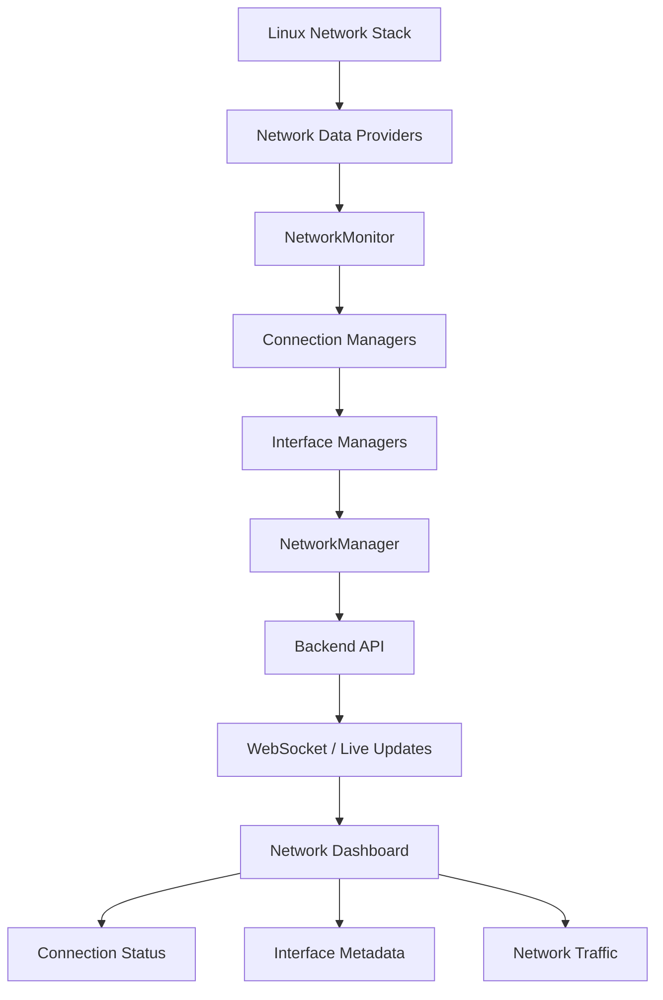

# Network Manager Plugin
## Implemented behavior (current contract)

The implementation monitors host interfaces and provides explicit server-side
connection controls through a single `NetworkController` class composed by
`NetworkManager`. IP addresses, subnet calculations, gateways, routes and DNS
remain read-only. The original requirements are retained below as a **design
proposal**; this section is authoritative about what is implemented.

### Architecture and data flow

`NetworkManagerPlugin` has a no-argument constructor and `register(app)`. It
creates a platform adapter (`create_platform_adapter()`), constructs a single
`NetworkController`, composes it into the prime `NetworkManager`, and registers
both `NetworkMonitor` (`app.extensions["network_manager"]`) and the control
routes (`app.extensions["network_controller"]`).

`NetworkController` (`app/plugins/network_manager/controller.py`) is the sole
coordinator for connection actions and deeper OS inventory:
- Wi-Fi scan (`wifi_scan`), connect (`wifi_connect` for open, saved profile, or
  WPA-personal), and disconnect (`wifi_disconnect`).
- Paired Bluetooth refresh (`bluetooth_refresh`), connect (`bluetooth_connect`),
  and disconnect (`bluetooth_disconnect`).
- Administrative interface link state (`interface_up`, `interface_down`).
- Native rollback checkpoints (`checkpoint_confirm`, `checkpoint_revert`) where
  supported by the OS provider (Linux NetworkManager Wi-Fi changes).

Platform-specific adapters (`app/plugins/network_manager/platforms/`) isolate
OS APIs beneath `NetworkController`:
- **Linux (`LinuxPlatformAdapter`)**: NetworkManager D-Bus (`dbus-next`) for
  Wi-Fi discovery, open/WPA-personal/saved connections, disconnect, checkpoints,
  and IP/gateway/DNS/route details; BlueZ D-Bus for paired Bluetooth devices;
  `ip link` for administrative up/down and `ip -j route` fallback inspection.
- **macOS (`MacOSPlatformAdapter`)**: CoreWLAN (`pyobjc-framework-CoreWLAN`) for
  Wi-Fi scan/association/disassociation; `SystemConfiguration` dynamic store for
  cached gateways/DNS/routes/method; `ifconfig` for administrative up/down;
  optional `blueutil --format json` for paired Bluetooth devices.
- **Windows (`WindowsPlatformAdapter`)**: Native `wlanapi.dll` via `ctypes` for
  Wi-Fi inventory/scan/connect/disconnect (credentials stay in memory); static
  PowerShell (`NetAdapter`/`NetTCPIP`) with JSON stdin for administrative
  enable/disable and route/DNS inspection. Windows classic Bluetooth has no
  generic profile connection API, so Bluetooth actions report `supported: false`
  with an explicit reason.

Optional platform packages are listed in `requirements-network.txt`.

`NetworkManager` owns `WiFiManager`, `EthernetManager`, `BluetoothManager`, and
`HotspotManager`, all subclasses of `ConnectionManager`. Each owns independent
`InterfaceManager` instances, which track counters, monotonic baselines, and
normalized IPv4/IPv6 subnet details (`prefix_length`, `network_cidr`,
`network_address`, `subnet_broadcast`, `scope_id` via `inspection.py`).

### Capabilities and interpretation

- psutil works without optional tools: addresses, MAC, link status, speed, MTU,
  byte counters, receive/transmit byte rates. Unsupported speed is `null`.
- On Linux, sysfs confirms wireless and physical Ethernet interfaces. Virtual
  interfaces (including veth, bridges, loopback, and tunnels) remain `other`;
  names and NetworkManager's generic Ethernet type are not sufficient evidence.
  Non-Linux interface types remain `other` unless a future provider identifies them.
- Optional `nmcli -t -e yes -f DEVICE,TYPE,STATE device status` supplies local
  NetworkManager device state and identifies Wi-Fi/Bluetooth network interfaces.
  `connected` means device/connection state, **not internet connectivity**.
- Optional `iw dev` supplies local wireless mode and SSID when present. Only
  explicit `type AP` identifies `hotspot`; a Wi-Fi link alone never does.
  AP mode does not prove clients, DHCP, routing, or internet access.
- Tool paths are detected once per provider. Commands use argument lists,
  `LC_ALL=C`, no shell, and a 0.7-second timeout each; at most two commands run
  per metadata refresh. No scans, pings, remote probes, root, or network writes.
- `capabilities` reports support/availability for psutil, discovery, counters,
  metadata, nmcli, iw, BlueZ, D-Bus, Netlink and internet-connectivity detection.
  Absent optional tools are unsupported, not errors. Installed tools that fail
  mark the snapshot `degraded`, without preventing generic monitoring.
- Link-up without provider connection evidence is `unknown`, link-down is
  `disconnected` even if cached metadata says connected (explicit connecting or
  unavailable metadata is retained). Missing technology interfaces produce an `unavailable` section.
  Bluetooth adapter/device discovery via BlueZ, wireless signal strength,
  connection profiles, route details, D-Bus and pyroute2 are **not implemented**.
  Bluetooth is only classified when an existing psutil network interface is
  positively identified as Bluetooth by NetworkManager.

### Sampling and configuration

Quart config takes precedence over environment variables:

- `SHELL_APP_NETWORK_INTERVAL`: seconds between traffic samples, default `2`.
- `SHELL_APP_NETWORK_DISCOVERY_INTERVAL`: discovery cadence, default `5`.
- `SHELL_APP_NETWORK_METADATA_INTERVAL`: optional metadata cadence, default `10`.

Values must be finite numbers at least 0.25 seconds; invalid values use defaults.
Slow discovery/metadata values are cached and may lag actual state by their
refresh interval. Counter samples use actual monotonic elapsed time (not a fixed
assumed interval). First observations, resets, reappearances and samples following
counter failures have `null` rates. Disappearing devices are removed immediately
when the counter inventory changes. New devices appear as `other`/`unknown` until
discovery refreshes. Discovery failures retain the last inventory but explicitly
mark connection state unknown and snapshot degraded; metadata exceptions clear
metadata rather than preserving an old connected state.

Totals sum **all** observed interfaces, including loopback/virtual interfaces, so
they are host interface traffic, not unique WAN throughput; layered interfaces
can double-count packets. A total is null if any contributing rate is unknown.
History holds approximately one hour of compact samples with the shared service's
14,400-sample cap. Use one app worker to monitor one host: multiple workers each
maintain an independent collector, snapshot, history and WebSocket subscribers.

### API contract

- `GET /api/network-manager`: cached snapshot directly (includes `control` snapshot).
- `GET /api/network-manager/history?seconds=60&limit=600`:
  `{"samples": [compact snapshot, ...]}`. Seconds must be `1..3600` and limit
  `1..600`; invalid queries return 400. Compact history excludes `control`.
- `GET /api/network-manager/control`: cached `NetworkController` snapshot
  (`platform`, `capabilities`, `interfaces`, `wifi_networks`,
  `bluetooth_devices`, `details`, `operations`, `updated_at`).
- `GET /api/network-manager/operations/<id>`: single operation record or 404.
- `POST /api/network-manager/actions`: flat JSON action dispatch requiring
  `Content-Type: application/json`, `X-Network-Control: 1`, and same-origin
  integrity. Returns HTTP 202 `{"operation": record}`. Wi-Fi passwords are
  redacted and never echoed or stored by the application.
- `WS /ws/network-manager`: initial `{"type":"snapshot","data":snapshot}`, then
  `{"type":"update","data":snapshot}`. No full history is sent on every update.

Initial shared snapshot: `{"timestamp":null,"status":"starting"}`. Normal fields:

- `timestamp`: numeric UNIX seconds; `status`: `ok` or `degraded`.
- `interfaces`: array containing `name`, `type` (`wifi`, `ethernet`, `bluetooth`,
  `hotspot`, `other`), `state` (`connected`, `disconnected`, `connecting`,
  `unavailable`, `unknown`), `is_up` boolean, `addresses` array
  (`family`, `address`, `netmask`, `broadcast`), nullable `mac`, nullable
  `speed_mbps`, nullable `mtu`, integer `bytes_recv`, integer `bytes_sent`,
  nullable numeric `recv_rate`, nullable numeric `sent_rate`, and `metadata`.
  Rates are bytes per second. Address families are names such as `AF_INET`.
- `connections`: `wifi`, `ethernet`, `bluetooth`, and `hotspot` objects, each
  containing `state` and `interfaces` (interface-name array).
- `totals`: nullable numeric `recv_rate` and `sent_rate`.
- `capabilities`: provider-specific objects with support/availability flags and
  generic, non-sensitive errors where appropriate.

Compact history contains **only** `timestamp`, `totals`, and `interfaces` objects
containing **only** `name`, `recv_rate`, and `sent_rate`. Shared unexpected collector
errors use `status:"error"` and retain the previous snapshot timestamp; consumers
must not treat that timestamp as fresh.

### Extension seams and validation

Provider `discover()` and `counters()` methods can be replaced independently.
Metadata providers implement `collect(interfaces)` returning normalized per-name
metadata and capability flags. Future D-Bus (NetworkManager/BlueZ) and Netlink
providers should update caches from events, own lifecycle cleanup, preserve
unsupported/error distinctions, and never start a collector per browser.

Deterministic tests in `tests/test_network_manager.py` cover split cadences,
monotonic rates, resets, disappearance/reappearance, failures and recovery,
independent manager ownership, virtual-interface classification, optional-tool
timeouts/unsupported platforms, AP-only hotspot evidence, compact history, config
validation, and cached HTTP routes. Linux tool parsing is fake-tested; actual
hardware, NetworkManager/BlueZ daemons and internet connectivity are not verified.

### Frontend architecture

`static/js/plugins/network_manager/plugin.js` exports `NetworkManagerPlugin`,
extending the existing shell `Plugin`; honeycomb registers it as **Network
Manager**. `NetworkDashboard` builds four technology summaries and a selectable
interface inspector with addresses, counters and provider metadata. Shared
`MonitoringDashboard`, `ReconnectingTransport`, `BoundedSeries`, and `CanvasChart`
classes in `static/js/plugins/monitoring/` handle lifecycle, history and transport.
Scoped styles live in `static/css/monitoring.css`; no chart CDN is required.

Native canvas charts plot aggregate and selected-interface RX/TX rates. One-time
history loading and explicit range changes fetch cached REST history; live data
comes only through WebSockets. Socket-first history reconciliation prevents
in-flight live samples from being overwritten. A missing selected interface
stays explicitly unavailable rather than silently selecting a different device.
OS-derived names/addresses/metadata are rendered as text, never injected as HTML.

Browser state is bounded to 14,400 compact samples within a one-hour window and
600 drawn points per chart line. Reconnect backoff is bounded, null rates create
gaps, and stale/error states are explicit. Minimized/hidden panels skip rendering.
Closing disposes sockets, fetches, timers, observers and event listeners.

Tests run with `node --test static/js/plugins/monitoring/monitoring.test.mjs`.
Endpoints share the existing app trust boundary and expose host addresses and
interface metadata; use reverse-proxy access controls outside a trusted network.

## Original design proposal (requirements retained; not an implementation claim)

## 1. Overview

The Network Manager plugin will provide an interactive dashboard for monitoring the network infrastructure of the underlying Raspberry Pi or Linux server.

The plugin will be responsible for discovering, tracking, and displaying different network connection types, including:

- Wi-Fi
- Ethernet / Wired
- Bluetooth
- Wi-Fi Hotspot

The initial implementation will be strictly **read-only**. All network connection establishment, disconnection, and configuration modifications will be handled through the Terminal plugin.

## 2. Architecture

The plugin will follow a three-level object architecture consisting of three primary classes:

### Object Hierarchy

### 2.1 NetworkManager

NetworkManager will act as the prime object and main entry point for the entire plugin.

Its responsibilities include:

- Initializing and maintaining different connection managers.
- Aggregating network information from all connection managers.
- Providing a unified network overview.
- Tracking the overall network state.
- Exposing network information to the frontend.

### 2.2 ConnectionManager

ConnectionManager will be the base class inherited by all specialized connection managers.

Each specialized manager will be responsible for retrieving and maintaining information about its respective connection technology.

Examples:

- WiFiManager
- BluetoothManager
- HotspotManager
- EthernetManager

Each connection manager will maintain its associated InterfaceManager instances and provide connection-specific metadata to NetworkManager.

### 2.3 InterfaceManager

InterfaceManager will be responsible for maintaining information about individual network interfaces.

It will track:

- Interface name and type.
- Interface UP/DOWN status.
- Associated connection information.
- IP and MAC addresses.
- Interface statistics.
- Incoming and outgoing network traffic.

A ConnectionManager may maintain multiple InterfaceManager instances.

InterfaceManager will operate independently and will not inherit from ConnectionManager.

## 3. Libraries and Data Collection

The plugin will interact with the underlying Linux networking infrastructure through dedicated Python libraries and system services.

| Library / Utility | Responsibility |
|---|---|
| psutil | Interface discovery, status, IP addresses and traffic statistics |
| NetworkManager D-Bus | Active connections, connection profiles and connection states |
| iw | Wi-Fi-specific information such as SSID and signal strength |
| BlueZ D-Bus | Bluetooth adapter and device information |
| pyroute2 | Interface and routing information, including network state events |

These dependencies will be abstracted behind a provider layer so that the manager classes do not directly depend on Linux-specific implementation details.

## 4. Real-Time Network Monitoring

The plugin must continuously monitor network information and reflect changes in the frontend without requiring a manual page refresh.

For this purpose, a background NetworkMonitor component will be introduced.

### Monitoring Workflow

1. NetworkMonitor periodically collects information from the underlying network providers.
2. The collected information is passed through the respective connection managers.
3. Each connection manager updates its associated InterfaceManager instances.
4. NetworkManager aggregates the latest network state.
5. The backend publishes updated network information to the frontend.
6. The frontend dynamically updates the connection status and interface metadata.

### Real-Time Data Flow

### Monitoring Mechanism

The initial implementation will use periodic polling to retrieve network information.

Suggested monitoring intervals:

| Information | Refresh Interval |
|---|---|
| Connection status | 3–5 seconds |
| Interface status | 3–5 seconds |
| IP configuration | 10 seconds |
| Network traffic | 1–2 seconds |
| Wireless metadata | 5 seconds |

For real-time frontend updates, WebSockets will be used to publish updated network states whenever changes are detected.

Where supported, D-Bus and Netlink events should be used to detect state changes without waiting for the next polling interval.

## 5. Frontend Representation

The Network Manager dashboard will provide a centralized view of all discovered network connections.

Each connection type will have its own section displaying its current state and associated interface information.

The UI should dynamically represent the following states:

- **Connected:** Connection is successfully established.
- **Disconnected:** No active connection exists.
- **Connecting:** Connection establishment is in progress.
- **Unavailable:** Interface or networking device is unavailable.
- **Unknown:** Connection state could not be determined.

Selecting a connection or interface should display its detailed metadata, including IP address, MAC address, signal strength where applicable, and network traffic statistics.

All displayed information will be updated dynamically through backend monitoring events.

## 6. Implementation Scope

The implementation will be divided into the following stages:

1. Implement the three primary classes and their object relationships.
2. Integrate psutil for network interface discovery and monitoring.
3. Implement specialized connection managers for Wi-Fi, Bluetooth, Hotspot and Ethernet.
4. Integrate the respective Linux networking providers.
5. Implement NetworkMonitor for background data collection.
6. Introduce WebSocket-based frontend updates.
7. Build the interactive network monitoring dashboard.

## 7. Architectural Constraints

- NetworkManager must remain the prime object.
- Specialized connection managers must inherit from ConnectionManager.
- InterfaceManager must remain an independent class.
- Connection managers must maintain their associated interface managers.
- Network monitoring must run independently of frontend requests.
- The frontend must receive normalized network information through backend APIs.
- The plugin must remain read-only.
- All network modifications must be performed through the Terminal plugin.

**Expected Outcome:** A centralized, interactive Network Manager dashboard that continuously discovers and monitors the network connections and interfaces of the underlying Linux hardware, displaying their current status and metadata in real time.