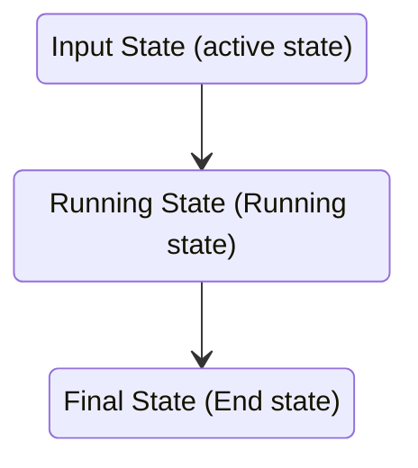

# the Terminal View subsystem
ok so the thing is i am thinking of a new age of a termial view with a very complex structre so that multiple seesion could be handeled in this modern terminal

## Techical structure of a Terminal Console

### Console Manager
the console manager will the Praent class responsible for the initalisation for the whole advance terminal subsystem 

having the following properties
* Panel Session List --> consist of the list Panel session Objects 
* Terminal map 

### Panel session
Panel session obejet will be the main obejject responsible for the construction of the terminal  panle spilt and dynamic management

which will consist of the following things
* Panel Tree --> this will be a Binalry Tree left node will be the number of terminal session (tatal)
### Panel Tree 
Panel Tree construction in Ui , Consoder it as adiv container being split inor the smaller div container liek a tree

**Logic behind the split of the Panel Tree**
Consider a Single root node of the Panel tree with the pane container div (two classses `pane-h`and `pane-v` for horizontal and vertical) split 
in which when the option of split is chosen in the active pane then 
according to the horizontal or vertical the root node create 2 child node (`pane-h`or `pane-v`) and the terminal session acive in the Root node will be moved to the left child of the tree and a new terminal session seession will be created and attached to the right one 

this similar logic applied for the split 

### Termainl Session
This Object will be the main termial user will be interaticn to in the main application panel nnwo this terminal will be having a contruction of command block Object in it and a input sectop at the bottom of
### The Command block
the Command bolck object will be coidered for each stdin command given by tthe user 
this consist of the following properties
* stdin --> what user inputs
* stdout ---> what is the teminal out put given

**Note** : FOr a terminal session object  untile one command block end in a terminal (ie the command user put and the otput doesnt completer by the termial no code block or stdin given to the cntainer but the thing is that the until and unlerss the command is running and the user typing andy thing the usr std out will be updated acordinly )

#### Command block logic 
The command block logic works the following way

**Input State (active state)**
this is the first state where te block s in inital state in which the block takes the user input (or the commnad) [Now the thing is that whatever which is input in the stdin simeulatanius ly being stremed in to the the terminal ]

**Running State (Running state)**
in this running state the command block streams the stdout in the out block but the thing is that the now the thing is that the stdout second could also take in the stdout block of the commnad bock as the commnad user execute could take further input 

**Final State (End state)**
This is the fila stage of the command bck which complets up the programmed and and the command block dtach form the active state and a new command block attach to the termial for the next input by the user
## Implemented in Shell App

- Open the Console tile to use `/console`. A panel session is a workspace tab and owns its split-pane tree.
- Horizontal splits place panes side by side; vertical splits stack them. Splitting keeps the active terminal and creates a new PTY-backed terminal beside it.
- Split dividers can be dragged to resize panes and can also be adjusted with the arrow keys when focused.
- `ConsoleManager` composes independent `PanelSession`, `PaneManager`, `TerminalTransport`, and `TerminalView` objects. Each submitted command becomes a `CommandBlock` that records stdin, streamed stdout, and the exit status.
- `TerminalTransport` manages the asynchronous WebSocket lifecycle and routes output by pane ID. A unique Bash prompt marker identifies command completion and its exit status; output is streamed to the active block until that marker arrives. While a command is running, the bottom command form is disabled and a dedicated input appears inside that block below its output. PTY echo is disabled while Bash waits for a command, then enabled while the command runs so interactive input appears in its output; the submitted command's echoed copy is filtered from stdout because it is already shown as stdin. Commands that disable echo keep password input hidden. After completion, the block input is removed, the bottom form is re-enabled, and any unsubmitted input becomes the next Input-state block.
- The console reads its colors from `static/css/variable.css`, follows the saved app theme across the homepage and console iframe, and defaults to dark when no theme preference exists. Command stdin is bold and separated from stdout by a thin divider.
- Console sessions are listed in a collapsible side navigation with controls to create, switch, and close sessions; the sidebar opens and closes with a smooth width transition.
- Pane dimensions are measured and sent to each PTY. The dashboard opens each selected panel in a viewport-filling overlay, expanding from its honeycomb tile. Panels have separate close and minimize controls; both shrink to the originating tile, and clicking a minimized panel's tile restores its existing state with the reverse animation. Escape closes the active panel.
- The command-block view is not a full-screen terminal emulator; interactive full-screen programs such as `nano`, `vim`, and `top` are not supported.
- The homepage Debug tile streams the app's rotating `debug.log`, `warning.log`, and `error.log` files from the configured `SHELL_APP_LOG_DIR` (defaulting to the user state directory). Startup and terminal-session lifecycle events are logged without recording terminal input. The warning and error files remain empty unless those levels are emitted. The log API accepts only these named files and handles log rotation while polling for updates.
