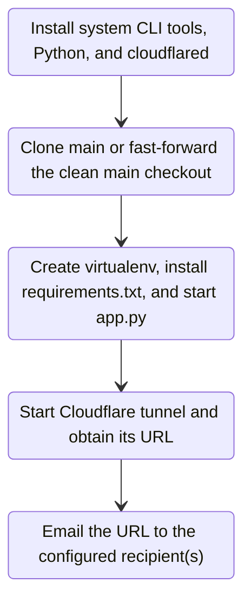

# Deploy Shell App on Linux

This guide installs Shell App as a systemd service on a Debian/Ubuntu-style
Linux server. To use the interactive installer, clone this repository and run:

```sh
sudo bash deploy/setup.sh
```

The installer creates the restricted `hat` account, asks for the Gmail address,
Google app password, and recipient(s), and stores the credentials in the
root-only `/etc/shell-app/shell-app.env`. Enter multiple recipients as a
comma-separated list. The installer installs the required Debian/Ubuntu CLI
tools, Python runtime/venv tooling, and `cloudflared`; SMTP is an external mail
service, so the installer configures Gmail's SMTP connection rather than
installing a mail server. The Gmail server host (`smtp.gmail.com`), port
(`587`), and STARTTLS encryption are configured automatically; this is Google's
SMTP endpoint, not a host or domain you need to buy. The installer prints
Google's app-password help link; App passwords require 2-Step Verification. It clones
the public repository at `https://github.com/Wansh619/Shell-App.git` to
`/opt/shell-app` or fast-forward updates an existing clean checkout on `main`;
no GitHub login is required. It writes all Shell App settings
(host, port, log directory, and session database path) to
`/etc/shell-app/sys.config`, installs dependencies and the systemd unit, then
starts the service. A symlink at `/opt/shell-app/deploy/sys.config` points to
the system config. Deployment-only values (SMTP settings, config path, and
service account) are set in the protected systemd environment file. SMTP
credentials stay with the privileged supervisor; it removes `SHELL_APP_*`
variables before launching child processes, then passes app settings loaded
from `sys.config` to the app.

The deployment sequence is:



By default, the service:

1. Starts the app on `0.0.0.0:5000`.
2. Waits for the local `/health` endpoint to respond.
3. Starts a Cloudflare Quick Tunnel to the app.
4. Emails the generated temporary URL to the configured recipients.

A new random `trycloudflare.com` URL is created and emailed each time the
service starts or restarts. Quick Tunnels are temporary and intended for
development and testing, not production.

## Important: the URL exposes an interactive shell

Anyone who obtains the URL can use the app's interactive terminal. The random
URL is difficult to guess, but it is **not authentication**. With the
interactive installer, terminal commands run as the restricted `hat` Linux
account, not as root. Use this only on a practice server with no sensitive data
or credentials accessible to that account. Do not expose port 5000 directly
to the internet.

In the server or cloud-provider firewall, allow only the inbound ports you
need for administration (for example, SSH) and block inbound TCP port `5000`.
The tunnel connects to the app over the server's loopback interface, so port
`5000` does not need to be open to the internet.

## 1. Install prerequisites

Use a Debian/Ubuntu-style Linux server with systemd and sudo access. The
installer adds Cloudflare's official stable APT repository and installs
`cloudflared` if it is not already available:

```sh
sudo bash deploy/setup.sh
```

## 2. Copy the application to `/opt/shell-app`

Skip this manual step when using `deploy/setup.sh`.

From a clone of this repository, run these commands at its root:

```sh
# Creates the root-owned installation directory with standard read/execute permissions.
sudo install -d -o root -g root -m 0755 /opt/shell-app
# Copies the app source and runtime assets from the current repository directory.
sudo cp -a app.py app requirements.txt static templates scripts /opt/shell-app/
# Copies the systemd unit and deployment configuration examples.
sudo cp -a deploy /opt/shell-app/
# Ensures the app files are owned by root, not by the account that runs terminal commands.
sudo chown -R root:root /opt/shell-app
```

Create and edit the app configuration:

```sh
sudo install -d -o root -g root -m 0700 /etc/shell-app
sudo install -o root -g root -m 0600 \
  /opt/shell-app/deploy/sys.config.example /etc/shell-app/sys.config
sudoedit /etc/shell-app/sys.config
```

The service unit expects this exact installation path. Keep the source tree
root-owned so the account running terminal commands cannot modify the app.
On reruns, the installer refuses a dirty or non-`main` checkout, preserves
existing `/etc/shell-app` configuration, installs updated Python requirements,
and restarts the service with the latest `main`.

## Backend plugins

The Quart backend is organized under `app/`: shared interfaces and route
registration live in `app/core/`, while built-in terminal and panel features
are registered from `app/plugins/`. To add a plugin, implement the `Plugin`
interface (`name` and `register(app)`), then pass it to `create_app`:

```python
import asyncio

from quart import Blueprint, Quart

from app import create_app, run_server


class ReportsPlugin:
    name = "reports"

    def register(self, app: Quart) -> None:
        routes = Blueprint("reports", __name__)

        @routes.get("/reports")
        async def reports():
            return {"reports": []}

        app.register_blueprint(routes)


if __name__ == "__main__":
    asyncio.run(run_server(application=create_app(plugins=[ReportsPlugin()])))
```

The default `app.py` entry point continues to start the built-in plugins.

## 3. Create the restricted service account and state directory

Skip this manual step when using `deploy/setup.sh`; it creates the restricted
`hat` account, state directory, and log directory.

```sh
# Creates the unprivileged Linux account used to run the app's terminal commands.
# --system creates a service account; --user-group creates its matching group.
# The home directory is /var/lib/shell-app and Bash is used for interactive terminals.
sudo useradd --system --user-group --home-dir /var/lib/shell-app --shell /bin/bash shell-app
# Creates the state directory and gives only the service account access to it.
sudo install -d -o shell-app -g shell-app -m 0750 /var/lib/shell-app
# Creates the log directory specified in sys.config.
sudo install -d -o shell-app -g shell-app -m 0750 /var/log/shell-app
```

If the `shell-app` account already exists, skip `useradd`.

## 4. Create the Python environment

Skip this manual step when using `deploy/setup.sh`.

```sh
# Creates an isolated Python environment alongside the deployed app.
sudo python3 -m venv /opt/shell-app/.venv
# Updates pip inside this virtual environment (not the system Python installation).
sudo /opt/shell-app/.venv/bin/pip install --upgrade pip
# Installs the Python dependencies declared by the app.
sudo /opt/shell-app/.venv/bin/pip install -r /opt/shell-app/requirements.txt
```

## 5. Configure email

Skip this manual step when using `deploy/setup.sh`; it prompts for the settings
and creates the protected environment file.

Create the service environment file and edit it:

```sh
# Creates a root-only directory for the SMTP credentials and service configuration.
sudo install -d -o root -g root -m 0700 /etc/shell-app
# Copies the example settings into the protected service environment file.
sudo install -o root -g root -m 0600 \
  /opt/shell-app/deploy/shell-app.env.example \
  /etc/shell-app/shell-app.env
# Opens the settings file in an editor running as root; replace all placeholders.
sudoedit /etc/shell-app/shell-app.env
```

Set these values:

| Setting | Meaning |
| --- | --- |
| `SHELL_APP_SMTP_HOST` | SMTP server hostname |
| `SHELL_APP_SMTP_PORT` | SMTP port; usually `587` for STARTTLS or `465` for SSL |
| `SHELL_APP_SMTP_STARTTLS` | `true` for STARTTLS, otherwise `false` |
| `SHELL_APP_SMTP_SSL` | `true` for implicit SSL, otherwise `false`; do not enable both TLS modes |
| `SHELL_APP_SMTP_USERNAME` | SMTP login, if required |
| `SHELL_APP_SMTP_PASSWORD` | SMTP password or provider-specific SMTP key, if required |
| `SHELL_APP_SMTP_FROM` | Verified sender address |
| `SHELL_APP_SMTP_TO` | Recipient address(es), comma-separated |

The example uses Gmail: set the host to `smtp.gmail.com`, port to `587`, and
STARTTLS to `true`. The sender should match the Gmail account used to
authenticate. Create a Google app password (requires 2-Step Verification);
do not use your normal Google account password. The recipient address can be
any email account.

Keep this file root-owned with mode `0600`. Do not commit it or put real
credentials in the repository. The systemd environment file uses systemd
syntax, not shell syntax; do not add `export` before variables.

## 6. Install and start the systemd service

Skip this manual step when using `deploy/setup.sh`.

```sh
# Installs the service unit where systemd looks for system-wide services.
sudo install -o root -g root -m 0644 \
  /opt/shell-app/deploy/systemd/shell-app.service \
  /etc/systemd/system/shell-app.service
# Makes systemd reload its unit files so it discovers shell-app.service.
sudo systemctl daemon-reload
# Enables the service at boot and starts it immediately.
sudo systemctl enable --now shell-app.service
```

Check the status and follow startup logs:

```sh
# Displays whether the service is active and recent status information.
sudo systemctl status shell-app.service
# Follows this service's journal output live; press Ctrl+C to stop following.
sudo journalctl -u shell-app.service -f
```

When healthy, the journal reports the Quick Tunnel URL and confirms that its
email was sent. Check the configured recipient's inbox and spam folder.

## Service details

- All Shell App settings come from `/etc/shell-app/sys.config`; environment
  variables do not override them. The configured `log` and `session_db` paths
  must be writable by the service account and permitted by systemd's
  `ReadWritePaths`.
- The systemd supervisor runs as root to read the protected mail configuration.
  It drops privileges before starting both the app and `cloudflared`. The app
  and terminal commands run as the configured service account (`hat` with the
  installer or `shell-app` in the manual instructions). SMTP credentials are
  not passed to either child process.
- A failed app startup, tunnel startup, or email send is reported in the system
  journal; systemd retries the service with a delay.

## Update the application

From the updated repository root, copy the source files into `/opt/shell-app`
while keeping that tree root-owned, then restart the service:

```sh
# Stops the app before replacing its files.
sudo systemctl stop shell-app.service
# Copies the updated application source and assets over the deployed version.
sudo cp -a app.py app requirements.txt static templates scripts /opt/shell-app/
# Keeps the deployed files root-owned after copying.
sudo chown -R root:root /opt/shell-app
# Synchronizes installed Python packages with the updated requirements file.
sudo /opt/shell-app/.venv/bin/pip install -r /opt/shell-app/requirements.txt
# Starts the updated app and creates a new Quick Tunnel URL.
sudo systemctl start shell-app.service
# Prints the latest 100 service log lines without opening an interactive pager.
sudo journalctl -u shell-app.service -n 100 --no-pager
```

If dependencies change, installing them before the restart is also fine as long
as the service is stopped while files are being replaced.

## Troubleshooting

**Service repeatedly restarts**

```sh
# Shows recent service errors and startup output to help diagnose restarts.
sudo journalctl -u shell-app.service -n 200 --no-pager
```

Look for a missing SMTP setting, invalid SMTP credentials, a sender address
that the provider has not verified, a missing `cloudflared` executable, or
another process already using port 5000.

**Quick Tunnel does not start**

```sh
# Shows where the cloudflared executable is installed; the service needs it on PATH.
command -v cloudflared
# Verifies cloudflared can run and reports its version.
cloudflared --version
```

Install it system-wide so it is on the service's restricted `PATH`, or add an
absolute `CLOUDFLARED_BIN=/path/to/cloudflared` setting to the environment file.
Check that the server can make outbound network connections.

**No email arrives**

Read the service journal, verify SMTP host, port, and TLS settings, confirm the
credentials and verified sender with the mail provider, and check spam. The URL
is sent only after the tunnel starts successfully.

**The emailed URL stops working**

Quick Tunnel URLs are temporary. Restarting the service creates and emails a
new URL:

```sh
# Restarts the app and tunnel, causing a new temporary URL to be emailed.
sudo systemctl restart shell-app.service
# Follows startup logs so the new URL and email result can be observed.
sudo journalctl -u shell-app.service -f
```

## Stop or uninstall

Stop the service but leave it installed:

```sh
# Disables automatic start at boot and stops the currently running service.
sudo systemctl disable --now shell-app.service
```

To remove the service definition:

```sh
# Disables and stops the service before removing its systemd unit.
sudo systemctl disable --now shell-app.service
# Removes the installed unit file; this does not remove app files or data.
sudo rm /etc/systemd/system/shell-app.service
# Tells systemd to forget the unit that was just removed.
sudo systemctl daemon-reload
```

After stopping it, you may separately remove `/opt/shell-app`, the
`/etc/shell-app/shell-app.env` credentials file, and `/var/lib/shell-app`. The
last directory contains the app's logs and session database; copy anything you
want to keep before deleting it.
